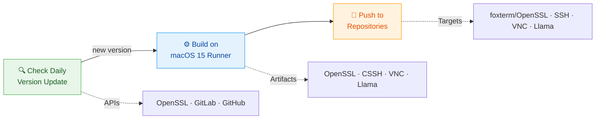
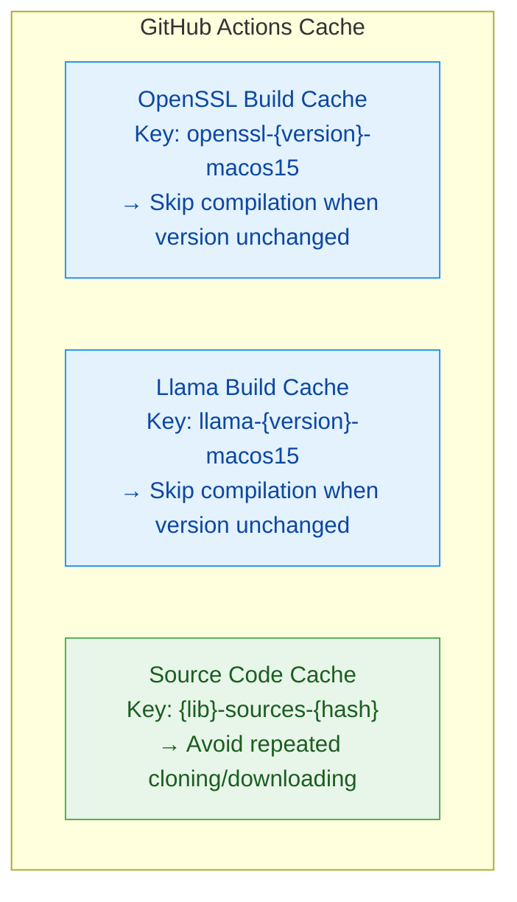

# FoxTerm XCFramework Build System

[English](README.md) | [中文文档](README_CN.md)

Automated compilation of OpenSSL / libssh / libvncserver / llama.cpp into Apple platform XCFrameworks — with daily dependency version checks and auto-push to target repositories.

> This library is a dedicated core component for the [FoxTerm](https://foxterm.app/) app. Download it here: [https://foxterm.app/](https://foxterm.app/)

[](https://github.com/foxterm/xcframework_build/actions/workflows/build-xcframeworks.yml)
[](https://github.com/foxterm/xcframework_build/actions/workflows/check-versions.yml)
[]()

---

## Architecture Overview



## Build Artifacts

| XCFramework | Source Library | Architecture Support | Output Location |
|-------------|----------------|---------------------|-----------------|
| `OpenSSL.xcframework` | [openssl/openssl](https://github.com/openssl/openssl) | macOS arm64/x86_64, iOS arm64, Simulator arm64 | [foxterm/OpenSSL](https://github.com/foxterm/OpenSSL) |
| `libssh.xcframework` | [libssh/libssh](https://gitlab.com/libssh/libssh-mirror) | macOS arm64/x86_64, iOS arm64, Simulator arm64 | [foxterm/SSH](https://github.com/foxterm/SSH) |
| `libvncclient.xcframework` | [LibVNC/libvncserver](https://github.com/LibVNC/libvncserver) | macOS arm64/x86_64, iOS arm64, Simulator arm64 | [foxterm/VNC](https://github.com/foxterm/VNC) |
| `llama.xcframework` | [ggml-org/llama.cpp](https://github.com/ggml-org/llama.cpp) | macOS arm64/x86_64, iOS arm64, Simulator arm64 | [foxterm/Llama](https://github.com/foxterm/Llama) |

## Core Features

### Extreme Size Optimization

OpenSSL compilation uses aggressive trimming strategy, keeping only APIs actually used by FoxTerm:

```bash
# Kept: AES, DES, ChaCha20, RSA, ECDSA, Ed25519, ECDH, X25519, SHA-1/2, TLS/SSL, X509
# Trimmed: 30+ unnecessary algorithms and modules

# Compilation optimization: -Oz (minimum size) + strip -x (strip local symbols)
# Merge: libssl.a + libcrypto.a → libopenssl.a (single library)
```

### Automated Version Detection

Automatically checks for dependency updates daily at UTC 00:00:

| Dependency | Detection Method | Data Source |
|------------|------------------|-------------|
| OpenSSL | GitHub Tags API | `api.github.com/repos/openssl/openssl/tags` |
| libssh | GitLab Tags API | `gitlab.com/api/v4/projects/libssh%2Flibssh-mirror/repository/tags` |
| libvncserver | Commit SHA Comparison | `api.github.com/repos/LibVNC/libvncserver/commits/master` |
| llama.cpp | GitHub Latest Release | `api.github.com/repos/ggml-org/llama.cpp/releases/latest` |

When new versions are detected, automatically:
1. Updates version numbers in build scripts
2. Commits changes to repository
3. Triggers build workflow

### Smart Caching



## Build Pipeline

```
Build XCFrameworks Workflow
│
├─▶ Install Dependencies (cmake, ninja, nasm, ...)
│
├─▶ Build OpenSSL
│   ├─ Restore cache (version-based)
│   ├─ Clone source (if not cached)
│   ├─ Configure (4 architectures)
│   ├─ Compile with -Oz optimization
│   ├─ Merge libssl + libcrypto
│   └─ Save cache
│
├─▶ Build CSSH (libssh)
│   ├─ Link against OpenSSL artifacts
│   ├─ Compile (4 architectures)
│   └─ Package xcframework
│
├─▶ Build VNC (libvncserver)
│   ├─ Build dependencies (libjpeg-turbo, libpng, lzo)
│   ├─ Link against OpenSSL artifacts
│   ├─ Compile (4 architectures)
│   └─ Package xcframework
│
├─▶ Build Llama (llama.cpp)
│   └─ Run official build-xcframework.sh (ios-sim ios-device macos) → llama.xcframework
│
└─▶ Push to Target Repos
    ├─ foxterm/OpenSSL ← OpenSSL.xcframework
    ├─ foxterm/SSH ← libssh.xcframework
    ├─ foxterm/VNC ← libvncclient.xcframework
    └─ foxterm/Llama ← llama.xcframework
```

## Manual Build Trigger

### Build All

```bash
gh workflow run build-xcframeworks.yml -R foxterm/xcframework_build -f build_libs=all
```

### Build Specific Libraries Only

```bash
# OpenSSL only
gh workflow run build-xcframeworks.yml -R foxterm/xcframework_build -f build_libs=openssl

# OpenSSL + CSSH
gh workflow run build-xcframeworks.yml -R foxterm/xcframework_build -f build_libs=openssl+cssh

# VNC only (requires OpenSSL cache)
gh workflow run build-xcframeworks.yml -R foxterm/xcframework_build -f build_libs=vnc

# Llama only (standalone, no OpenSSL needed)
gh workflow run build-xcframeworks.yml -R foxterm/xcframework_build -f build_libs=llama
```

## Local Build

### Prerequisites

```bash
# macOS
brew install cmake ninja libtool autoconf automake nasm

# Xcode Command Line Tools
xcode-select --install
```

### Build OpenSSL

```bash
cd OpenSSL
bash build_xcframework.sh
```

### Build CSSH (libssh)

```bash
cd CSSH
# Ensure OpenSSL is built to ../openssl_xcframework_build/
bash build_xcframework.sh
```

### Build VNC (libvncserver)

```bash
cd VNC
# Ensure OpenSSL is built to ../openssl_xcframework_build/
bash build_xcframework.sh
```

### Build Llama (llama.cpp)

Uses the official llama.cpp build script (no custom build script in this repo):

```bash
# 1. Clone llama.cpp
git clone --depth 1 --branch v0.8.0 https://github.com/ggml-org/llama.cpp.git
cd llama.cpp

# 2. Build via official script (iOS Simulator, iOS Device, macOS)
./build-xcframework.sh ios-sim ios-device macos

# 3. Output: build-apple/llama.xcframework
```

## Repository Structure

```
xcframework_build/
├── .github/
│   └── workflows/
│       ├── build-xcframeworks.yml    # Build workflow
│       └── check-versions.yml        # Version check workflow
├── OpenSSL/
│   ├── build_xcframework.sh          # OpenSSL build script
│   └── openssl_xcframework_build/    # Build artifacts (gitignored)
├── CSSH/
│   ├── build_xcframework.sh          # libssh build script
│   └── xcframework_build/            # Build artifacts (gitignored)
├── VNC/
│   ├── build_xcframework.sh          # libvncserver build script
│   └── xcframework_build/            # Build artifacts (gitignored)
├── vnc_master_hash.txt               # libvncserver master branch tracking
├── llama_version.txt                 # llama.cpp version tracking (CI-maintained)
├── README.md                         # English documentation
└── README_CN.md                      # Chinese documentation
```

## Environment Variables

Build scripts support overriding default configuration via environment variables:

| Variable | Description | Default Value |
|----------|-------------|---------------|
| `OPENSSL_VERSION` | OpenSSL version tag | `openssl-4.1.0` |
| `LIBSSH_VERSION` | libssh version number | `0.12.2` |
| `OPENSSL_BUILD_DIR` | OpenSSL artifacts path (for CI) | Script relative path |

> Note: Llama version is tracked via `llama_version.txt` (updated by CI from llama.cpp GitHub Latest Release). No local version variable.

Example:
```bash
OPENSSL_VERSION="openssl-4.0.0" bash OpenSSL/build_xcframework.sh
```

## Secrets Configuration

| Secret | Description |
|--------|-------------|
| `GH_PAT` | GitHub Personal Access Token for cross-repository xcframework push |

PAT requires `repo` permission, used to push build artifacts to:
- `foxterm/OpenSSL`
- `foxterm/SSH`
- `foxterm/VNC`
- `foxterm/Llama`

## Technical Details

### Build Targets

| Platform | Architecture | Minimum Version |
|----------|--------------|-----------------|
| macOS | arm64, x86_64 | macOS 14.0 |
| iOS | arm64 | iOS 17.0 |
| iOS Simulator | arm64 | iOS 17.0 |

### OpenSSL Trim List

<details>
<summary>Click to expand full trim list</summary>

**Disabled Protocols:**
- SSL 3.0, TLS 1.0, TLS 1.1, DTLS

**Disabled Encryption Algorithms:**
- ARIA, Camellia, CAST, IDEA, RC2, RC5, SEED, SM2, SM3, SM4, Whirlpool, BLAKE2, RMD160, MD4

**Disabled Features:**
- Compression, OCB, CT, PSK, SRP, SRTP, Scrypt, TS, CMS, GOST, KTLS, FIPS

**Disabled Modules:**
- Engine, Dynamic modules, Filenames tracking, Async operations

</details>

### libvncserver Dependencies

VNC build includes the following statically linked dependencies:
- libjpeg-turbo (no SIMD)
- libpng
- LZO 2.10

### llama.cpp Build Approach

The Llama build **runs the official llama.cpp [build-xcframework.sh](https://github.com/ggml-org/llama.cpp/blob/master/build-xcframework.sh) directly** (no custom build script):

```bash
./build-xcframework.sh ios-sim ios-device macos
```

Official script handles everything:
- CMake + Xcode Generator, `Release` configuration
- Backends: `GGML_METAL=ON` (Apple GPU) + `GGML_BLAS=ON` (Accelerate) + CPU backend
- `GGML_METAL_EMBED_LIBRARY=ON`: embeds the `.metallib` into the library, no external resources needed
- Merges `libllama.a + libggml.a + libggml-base.a + libggml-cpu.a + libggml-metal.a + libggml-blas.a + libmtmd.a + libvendor-hash.a`
- Outputs a dynamic `llama.framework` per platform, then packages `build-apple/llama.xcframework`
- Version: latest GitHub Release tag (tracked in `llama_version.txt`, auto-detected by CI)

## License

Build scripts are licensed under the MIT License. Each dependency library follows its respective license:
- OpenSSL: [Apache License 2.0](https://github.com/openssl/openssl/blob/master/LICENSE.txt)
- libssh: [LGPL 2.1](https://gitlab.com/libssh/libssh-mirror/-/blob/master/COPYING)
- libvncserver: [GPL 2.0](https://github.com/LibVNC/libvncserver/blob/master/COPYING)
- llama.cpp: [MIT](https://github.com/ggml-org/llama.cpp/blob/master/LICENSE)
