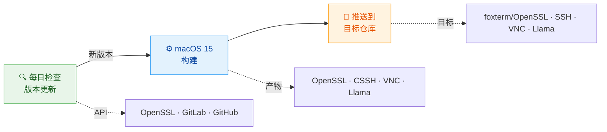
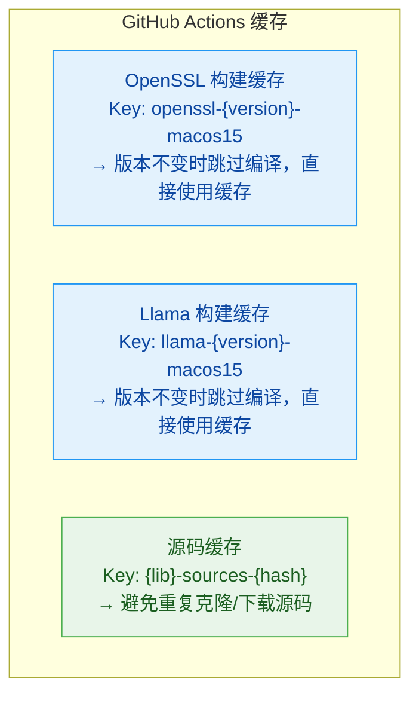

# FoxTerm XCFramework 构建系统

[English](README.md) | [中文文档](README_CN.md)

自动化编译 OpenSSL / libssh / libvncserver / llama.cpp 为 Apple 平台 XCFramework — 每日自动检测依赖版本更新并推送到目标仓库。

> 本库为 [FoxTerm](https://foxterm.app/) APP 专用核心组件，欢迎下载使用：[https://foxterm.app/](https://foxterm.app/)

[](https://github.com/foxterm/xcframework_build/actions/workflows/build-xcframeworks.yml)
[](https://github.com/foxterm/xcframework_build/actions/workflows/check-versions.yml)
[]()

---

## 架构概览


## 编译产物

| XCFramework | 源库 | 架构支持 | 输出位置 |
|-------------|------|----------|----------|
| `OpenSSL.xcframework` | [openssl/openssl](https://github.com/openssl/openssl) | macOS arm64/x86_64, iOS arm64, Simulator arm64 | [foxterm/OpenSSL](https://github.com/foxterm/OpenSSL) |
| `libssh.xcframework` | [libssh/libssh](https://gitlab.com/libssh/libssh-mirror) | macOS arm64/x86_64, iOS arm64, Simulator arm64 | [foxterm/SSH](https://github.com/foxterm/SSH) |
| `libvncclient.xcframework` | [LibVNC/libvncserver](https://github.com/LibVNC/libvncserver) | macOS arm64/x86_64, iOS arm64, Simulator arm64 | [foxterm/VNC](https://github.com/foxterm/VNC) |
| `llama.xcframework` | [ggml-org/llama.cpp](https://github.com/ggml-org/llama.cpp) | macOS arm64/x86_64, iOS arm64, Simulator arm64 | [foxterm/Llama](https://github.com/foxterm/Llama) |

## 核心特性

### 极致体积优化

OpenSSL 编译采用激进的裁剪策略，仅保留 FoxTerm 实际使用的 API：

```bash
# 保留: AES, DES, ChaCha20, RSA, ECDSA, Ed25519, ECDH, X25519, SHA-1/2, TLS/SSL, X509
# 裁剪: 30+ 不需要的算法和模块

# 编译优化: -Oz (最小体积) + strip -x (剥离本地符号)
# 合并: libssl.a + libcrypto.a → libopenssl.a (单库)
```

### 自动化版本检测

每天 UTC 00:00 自动检查依赖更新：

| 依赖 | 检测方式 | 数据源 |
|------|----------|--------|
| OpenSSL | GitHub Tags API | `api.github.com/repos/openssl/openssl/tags` |
| libssh | GitLab Tags API | `gitlab.com/api/v4/projects/libssh%2Flibssh-mirror/repository/tags` |
| libvncserver | Commit SHA 对比 | `api.github.com/repos/LibVNC/libvncserver/commits/master` |
| llama.cpp | GitHub Latest Release | `api.github.com/repos/ggml-org/llama.cpp/releases/latest` |

发现新版本时自动：
1. 更新构建脚本中的版本号
2. 提交变更到仓库
3. 触发构建工作流

### 智能缓存



## 构建流程

```
构建 XCFrameworks 工作流
│
├─▶ 安装依赖 (cmake, ninja, nasm, ...)
│
├─▶ 构建 OpenSSL
│   ├─ 恢复缓存 (基于版本)
│   ├─ 克隆源码 (如未缓存)
│   ├─ 配置 (4 个架构)
│   ├─ 使用 -Oz 优化编译
│   ├─ 合并 libssl + libcrypto
│   └─ 保存缓存
│
├─▶ 构建 CSSH (libssh)
│   ├─ 链接 OpenSSL 产物
│   ├─ 编译 (4 个架构)
│   └─ 打包 xcframework
│
├─▶ 构建 VNC (libvncserver)
│   ├─ 构建依赖 (libjpeg-turbo, libpng, lzo)
│   ├─ 链接 OpenSSL 产物
│   ├─ 编译 (4 个架构)
│   └─ 打包 xcframework
│
├─▶ 构建 Llama (llama.cpp)
│   └─ 直接运行官方 build-xcframework.sh (ios-sim ios-device macos) → llama.xcframework
│
└─▶ 推送到目标仓库
    ├─ foxterm/OpenSSL ← OpenSSL.xcframework
    ├─ foxterm/SSH ← libssh.xcframework
    ├─ foxterm/VNC ← libvncclient.xcframework
    └─ foxterm/Llama ← llama.xcframework
```

## 手动触发构建

### 构建全部

```bash
gh workflow run build-xcframeworks.yml -R foxterm/xcframework_build -f build_libs=all
```

### 仅构建特定库

```bash
# 仅 OpenSSL
gh workflow run build-xcframeworks.yml -R foxterm/xcframework_build -f build_libs=openssl

# OpenSSL + CSSH
gh workflow run build-xcframeworks.yml -R foxterm/xcframework_build -f build_libs=openssl+cssh

# 仅 VNC (需要 OpenSSL 缓存)
gh workflow run build-xcframeworks.yml -R foxterm/xcframework_build -f build_libs=vnc

# 仅 Llama (独立构建，无需 OpenSSL)
gh workflow run build-xcframeworks.yml -R foxterm/xcframework_build -f build_libs=llama
```

## 本地构建

### 前置要求

```bash
# macOS
brew install cmake ninja libtool autoconf automake nasm

# Xcode 命令行工具
xcode-select --install
```

### 编译 OpenSSL

```bash
cd OpenSSL
bash build_xcframework.sh
```

### 编译 CSSH (libssh)

```bash
cd CSSH
# 确保 OpenSSL 已编译到 ../openssl_xcframework_build/
bash build_xcframework.sh
```

### 编译 VNC (libvncserver)

```bash
cd VNC
# 确保 OpenSSL 已编译到 ../openssl_xcframework_build/
bash build_xcframework.sh
```

### 编译 Llama (llama.cpp)

本仓库不维护 llama.cpp 构建脚本，**直接使用官方 build-xcframework.sh**：

```bash
# 1. 克隆 llama.cpp
git clone --depth 1 --branch v0.8.0 https://github.com/ggml-org/llama.cpp.git
cd llama.cpp

# 2. 官方脚本编译 (iOS 模拟器 / iOS 真机 / macOS)
./build-xcframework.sh ios-sim ios-device macos

# 3. 输出: build-apple/llama.xcframework
```

## 仓库结构

```
xcframework_build/
├── .github/
│   └── workflows/
│       ├── build-xcframeworks.yml    # 构建工作流
│       └── check-versions.yml        # 版本检测工作流
├── OpenSSL/
│   ├── build_xcframework.sh          # OpenSSL 构建脚本
│   └── openssl_xcframework_build/    # 构建产物 (gitignored)
├── CSSH/
│   ├── build_xcframework.sh          # libssh 构建脚本
│   └── xcframework_build/            # 构建产物 (gitignored)
├── VNC/
│   ├── build_xcframework.sh          # libvncserver 构建脚本
│   └── xcframework_build/            # 构建产物 (gitignored)
├── vnc_master_hash.txt               # libvncserver master 分支追踪
├── llama_version.txt                 # llama.cpp 版本追踪 (CI 维护)
├── README.md                         # 英文文档
└── README_CN.md                      # 中文文档
```

## 环境变量

构建脚本支持通过环境变量覆盖默认配置：

| 变量 | 说明 | 默认值 |
|------|------|--------|
| `OPENSSL_VERSION` | OpenSSL 版本标签 | `openssl-4.1.0` |
| `LIBSSH_VERSION` | libssh 版本号 | `0.12.2` |
| `OPENSSL_BUILD_DIR` | OpenSSL 产物路径 (CI 用) | 脚本相对路径 |

> 注：Llama 版本通过 `llama_version.txt` 追踪（CI 从 llama.cpp GitHub Latest Release 自动更新），无本地版本变量。

示例：
```bash
OPENSSL_VERSION="openssl-4.0.0" bash OpenSSL/build_xcframework.sh
```

## Secrets 配置

| Secret | 说明 |
|--------|------|
| `GH_PAT` | GitHub Personal Access Token，用于跨仓库推送 xcframework |

PAT 需要 `repo` 权限，用于推送构建产物到：
- `foxterm/OpenSSL`
- `foxterm/SSH`
- `foxterm/VNC`
- `foxterm/Llama`

## 技术细节

### 编译目标

| 平台 | 架构 | 最低版本 |
|------|------|----------|
| macOS | arm64, x86_64 | macOS 14.0 |
| iOS | arm64 | iOS 17.0 |
| iOS Simulator | arm64 | iOS 17.0 |

### OpenSSL 裁剪清单

<details>
<summary>点击展开完整裁剪列表</summary>

**禁用的协议:**
- SSL 3.0, TLS 1.0, TLS 1.1, DTLS

**禁用的加密算法:**
- ARIA, Camellia, CAST, IDEA, RC2, RC5, SEED, SM2, SM3, SM4, Whirlpool, BLAKE2, RMD160, MD4

**禁用的功能:**
- Compression, OCB, CT, PSK, SRP, SRTP, Scrypt, TS, CMS, GOST, KTLS, FIPS

**禁用的模块:**
- Engine, Dynamic modules, Filenames tracking, Async operations

</details>

### libvncserver 依赖

VNC 构建包含以下静态链接的依赖：
- libjpeg-turbo (无 SIMD)
- libpng
- LZO 2.10

### llama.cpp 构建方式

Llama 构建**直接运行官方 [build-xcframework.sh](https://github.com/ggml-org/llama.cpp/blob/master/build-xcframework.sh)**（本仓库不维护自定义构建脚本）：

```bash
./build-xcframework.sh ios-sim ios-device macos
```

官方脚本负责全部流程：
- 编译选项：CMake + Xcode Generator，`Release` 配置
- 后端：`GGML_METAL=ON`（Apple GPU）+ `GGML_BLAS=ON`（Accelerate）+ CPU 后端
- `GGML_METAL_EMBED_LIBRARY=ON`：将 `.metallib` 嵌入库中，消费方无需外部资源
- 合并 `libllama.a + libggml.a + libggml-base.a + libggml-cpu.a + libggml-metal.a + libggml-blas.a + libmtmd.a + libvendor-hash.a`
- 每平台产出动态 `llama.framework`，最终打包为 `build-apple/llama.xcframework`
- 版本：GitHub Latest Release tag（记录于 `llama_version.txt`，由 CI 自动检测）

## 许可证

构建脚本遵循 MIT 许可证。各依赖库遵循其各自的许可证：
- OpenSSL: [Apache License 2.0](https://github.com/openssl/openssl/blob/master/LICENSE.txt)
- libssh: [LGPL 2.1](https://gitlab.com/libssh/libssh-mirror/-/blob/master/COPYING)
- libvncserver: [GPL 2.0](https://github.com/LibVNC/libvncserver/blob/master/COPYING)
- llama.cpp: [MIT](https://github.com/ggml-org/llama.cpp/blob/master/LICENSE)
